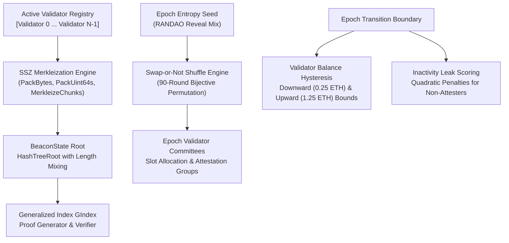

# BeaconSynapse

[](https://github.com/ZengLLQ/beacon-synapse/actions/workflows/ci.yml)
[](LICENSE)
[](https://go.dev)

**BeaconSynapse** is a high-performance Go library implementing the core algorithmic primitives of the **Ethereum 2.0 Proof-of-Stake Consensus Specification**:
- **SSZ (Simple Serialize) Merkleization Engine**: Chunker, bitvector/uint64 packing, length mixing, and generalized index tree hashing.
- **Merkle Branch Multi-Proof Verification**: Generalized index ($g_{\text{index}} = 2^{\text{depth}} + i$) verification and automated proof branch synthesis.
- **Swap-or-Not Validator Committee Shuffling**: Cryptographic pseudorandom permutation of active validator sets into unbiasable epoch committees.
- **Validator State & Inactivity Leak Accounting**: Effective balance hysteresis mechanics and quadratic inactivity leak penalties under lack of finality.

---

## Architecture & Primitives



---

## Core Specification Highlights

### 1. Generalized Index ($G_{\text{index}}$) & Merkle Multi-Proofs

In SSZ binary Merkle trees, navigation is indexed by integer $k$:
- Root is $k = 1$.
- Left child of node $k$ is $2k$.
- Right child of node $k$ is $2k + 1$.
- Sibling of node $k$ is $k \oplus 1$.
- For leaf at index $i$ in a tree of depth $D$:
  $$g_{\text{index}} = 2^D + i$$

### 2. Swap-or-Not Shuffling

Ethereum validators are randomly partitioned into committee sets using 90 rounds of the Swap-or-Not shuffle:
- For round $r \in [0, 89]$:
  $$\text{pivot} = \text{bytes\_to\_int}(\text{sha256}(\text{seed} \parallel r)[0:8]) \pmod N$$
  $$\text{flip} = (\text{pivot} + N - i) \pmod N$$
  $$\text{bit} = \text{extract\_bit}(\text{sha256}(\text{seed} \parallel r \parallel \lfloor \max(i, \text{flip})/256 \rfloor))$$
  $$\text{if } \text{bit} = 1 \implies i \leftarrow \text{flip}$$

### 3. Effective Balance Hysteresis

Prevents constant beacon state churn when validator balances fluctuate slightly due to micro-attestation rewards:
- Thresholds are calibrated around increments of 1 ETH ($10^9$ Gwei):
  - Downward buffer: $0.25$ ETH ($1 \text{ ETH} / 4 \times 1$)
  - Upward buffer: $1.25$ ETH ($1 \text{ ETH} / 4 \times 5$)

---

## Quickstart

```go
package main

import (
	"fmt"
	"github.com/ZengLLQ/beacon-synapse/pkg/merkle"
	"github.com/ZengLLQ/beacon-synapse/pkg/shuffle"
	"github.com/ZengLLQ/beacon-synapse/pkg/ssz"
)

func main() {
	// 1. Merkleize chunks
	chunks := make([][32]byte, 4)
	chunks[0][0] = 0xAA
	root := ssz.MerkleizeChunks(chunks, 4)

	// 2. Generate and verify Merkle proof
	proof, gindex, _ := merkle.GenerateProof(chunks, 0)
	valid := merkle.VerifyProof(root, chunks[0], proof, gindex)
	fmt.Printf("Proof valid: %v\n", valid)

	// 3. Shuffle validator into epoch committee
	var seed [32]byte
	shuffledIdx, _ := shuffle.ComputeShuffledIndex(42, 1000, seed)
	fmt.Printf("Validator 42 mapped to shuffled position: %d\n", shuffledIdx)
}
```

---

## Testing

```bash
go test -v ./...
```

---

## License

MIT License. Copyright (c) 2026 ZengLLQ.
